# KML 卫星地图查看器

> **卫星图 KML 定位查询** · 纯前端静态网页 / 上传 KML 或 KMZ 文件，在 Esri、天地图、高德或腾讯地图上查看定位，点击要素即可查看名称、周长、面积等详细信息。

[](https://leafletjs.com/)
[](https://leafletjs.com/)
[](CHANGELOG.md)
[](doc/DEPLOY.md)
[](LICENSE)

[English](#english) | [中文](#中文)

---

## 中文

### ✨ 这是什么

- 一个**纯前端网页**，双击 `index.html` 就能用，无需安装任何环境；
- 上传 **KML / KMZ**（KMZ 自动解压），把里面的点、线、面画到 **Esri 卫星图（默认）/ 天地图卫星图 / 高德卫星图 / 高德普通地图 / 腾讯卫星图**上；
- 左侧每个地块前有**勾选框**：勾选显示在地图、取消勾选隐藏；顶部**筛选框**可按名称、备注、面积、坐标等任意信息过滤，地图同步只显示匹配要素；
- 鼠标点击任意要素即**选中并立即弹出信息卡**（参照谷歌地图）：地块自动居中到屏幕中央；选中区域同色加深、无白边；再点一次、点地图空白处、按 Esc 或点 × 即可取消；
- 左侧列表只列**地块**（面要素，含首尾闭合的线），双击即可定位；悬停仅做高亮，不弹任何提示；
- 侧栏支持**全局全选 / 全不选**、单位切换、**注记来源切换**（天地图注记 / Esri 注记 / 不显示），并可将当前地块**导出 CSV**（Excel 可直接打开）。

### 🎯 核心特性

| 特性 | 描述 |
| --- | --- |
| KML / KMZ 解析 | 支持多选、拖拽上传；KMZ 自动解压并优先读取 doc.kml |
| 五种底图 | 默认 Esri World Imagery；可切天地图卫星图（CGCS2000≈WGS84，无需纠偏）、高德卫星图（国内访问快）、高德普通地图（非卫星，路网注记齐全）或腾讯卫星图（GCJ-02 自动纠偏，自带腾讯注记），选择会被记住 |
| 天地图中文注记 | Esri 卫星图可叠加天地图透明注记（镇、村、社名与主要地名），CGCS2000≈WGS84 直接叠合无偏移；注记按天地图原生层级显示，字号不随放大变化 |
| 天地图卫星图 | 天地图 `img_w` 影像 + 自带 `cia_w` 注记，18 级真实影像封顶；与 KML 同为 WGS84 体系，不做 GCJ-02 偏移；需 `config.js` 配置天地图 tk |
| 腾讯卫星图 | 腾讯 `sateTiles` 影像 + 腾讯透明注记，18 级封顶；无需密钥，GCJ-02 自动纠偏；影像仅覆盖中国境内 |
| 坐标系自动纠偏 | 高德 / 腾讯瓦片为 GCJ-02 火星坐标，要素渲染时自动从 WGS84 偏移转换，切回 Esri / 天地图自动还原 |
| 勾选显隐 | 每个地块前有勾选框，勾选即显示、取消即隐藏，默认全部勾选；显示状态跨底图切换保持 |
| 全局全选 | 侧栏统计行「全选」复选框支持三态（全选 / 半选 / 全不选），一键切换当前列表全部地块；筛选时可批量调整勾选状态 |
| CSV 导出 | 「导出 CSV」导出当前可显示地块（筛选时=匹配行，否则=勾选行）；包含文件名、名称、类型、周长、面积、中心经纬度、备注；UTF-8 BOM + 全字段引号，Excel 打开不乱码 |
| 全字段筛选 | 侧栏筛选框输入任意关键字（名称 / 备注 / 类型 / 文件名 / 周长 / 面积 / 中心坐标），匹配的地块列入列表并在图上显示（含点、线）；清空后恢复勾选状态 |
| 面积 / 周长 | 按地球椭球面（WGS84）精确计算，面积单位可在平方米 / 公顷 / 亩 / 平方公里间切换 |
| 点击选中 | 点击要素或侧栏条目即选中并立即弹出信息卡；面（地块）自动平滑平移到屏幕中央（缩放不变，点/线不移动）；选中区域同色加深（面=深色半透明叠层、线=加粗、点=加深圆点），无白色描边；再点同一要素、点空白处、按 Esc 或点 × 取消 |
| 双击定位 | 双击侧栏条目飞至要素，缩放自动封顶在底图有真实影像的层级（Esri / 高德 / 腾讯均为 18 级），不会放大到空白 |
| 清空复位 | 点「清空」移除全部图层并平滑飞回初始全球视野（底图、注记来源、面积单位等偏好保持不变），上传首页面板重新出现 |
| 闭合线按面 | 首尾重合（1 米内）的线自动按地块处理：显示填充、算面积周长、进侧栏、可勾选筛选；非闭合线与点只上图不入栏 |
| 紧凑信息卡 | 名称、类型、周长、面积、中心坐标、备注；备注 HTML 净化并剥离底色/色框等表现样式，表格排版更紧凑 |
| 编码兼容 | 自动识别 UTF-8 / GB18030 / GBK，兼容国内测绘软件导出的文件 |
| 样式还原 | 还原 KML 自带的线条与填充颜色；无样式时自动分配调色板 |
| 安全渲染 | 备注中的 HTML 做白名单净化，脚本、外链图片等危险内容一律移除 |
| 数据不出本机 | 全部解析在浏览器本地完成，文件不上传任何服务器 |

### 📸 界面

| 首页主题（半透明） | 加载效果 |
| --- | --- |
| 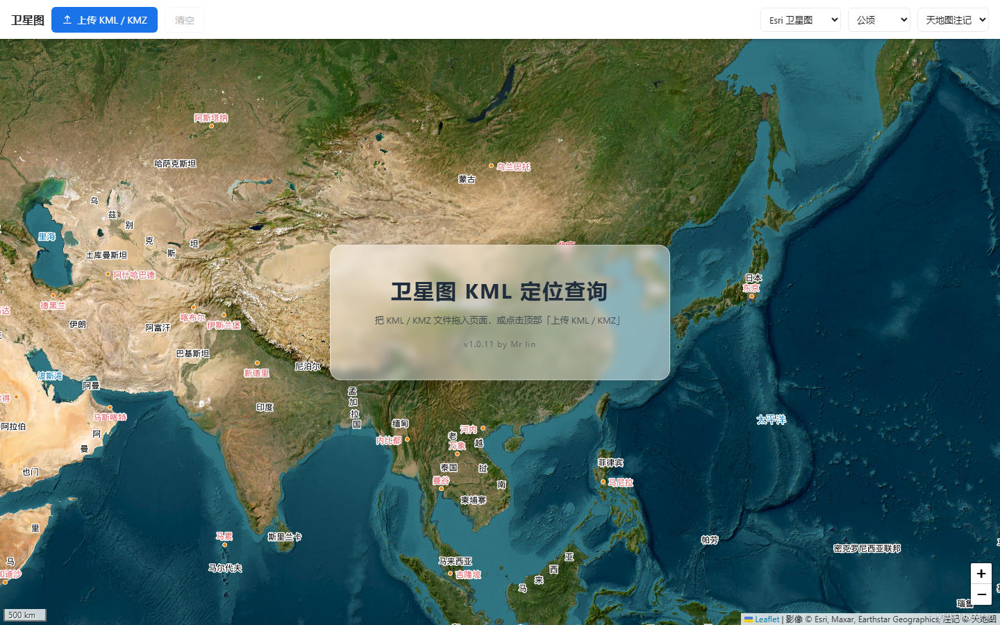 | 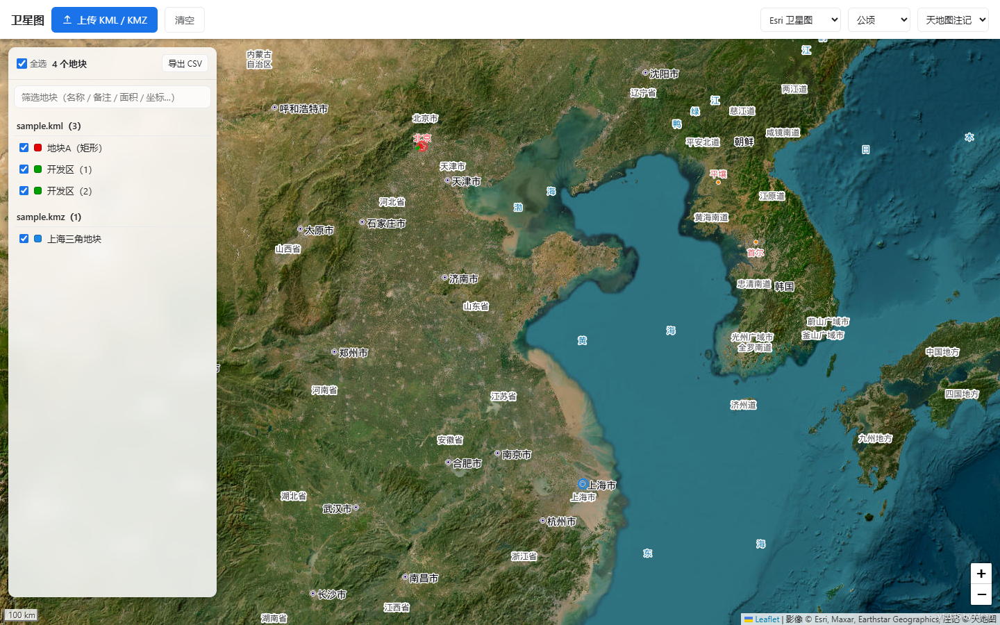 |

| 筛选 + 勾选 | 点击选中 + 信息卡 |
| --- | --- |
| 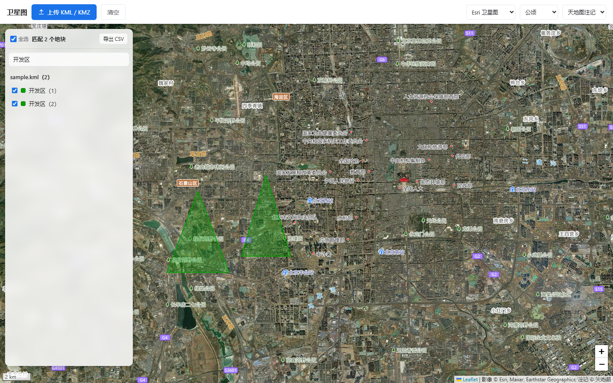 | 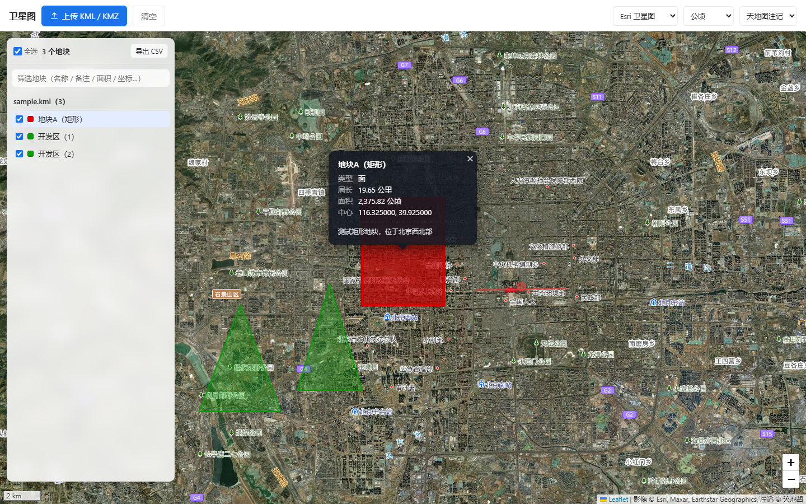 |

| 高德普通地图 | 天地图注记叠加 Esri 卫星图 |
| --- | --- |
| 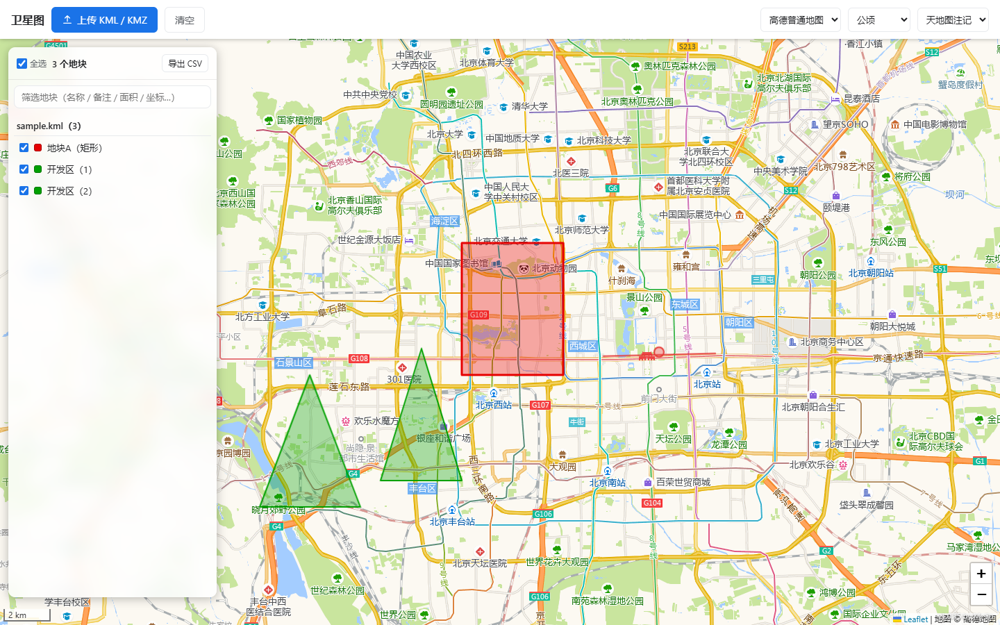 | 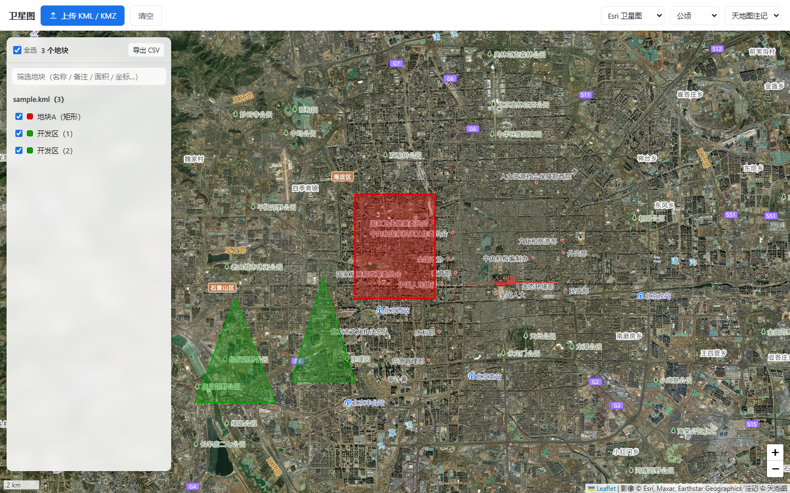 |

| 高德卫星图与选中态 |
| --- |
| 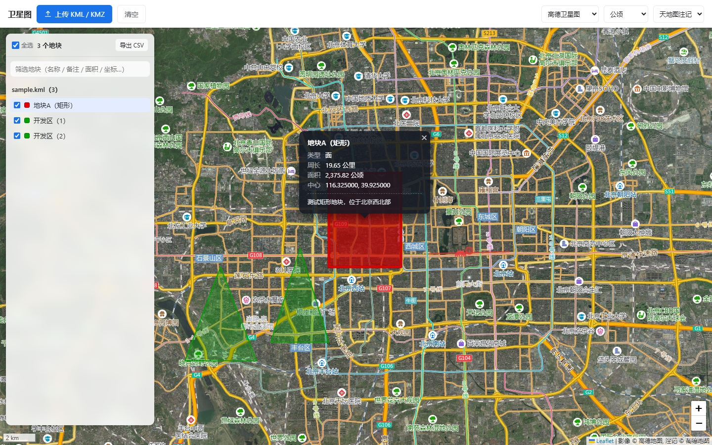 |

| 天地图卫星图 | 腾讯卫星图 |
| --- | --- |
| 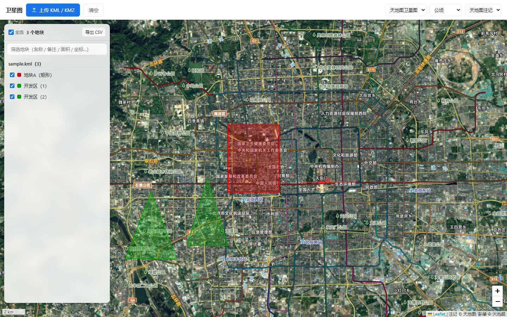 | 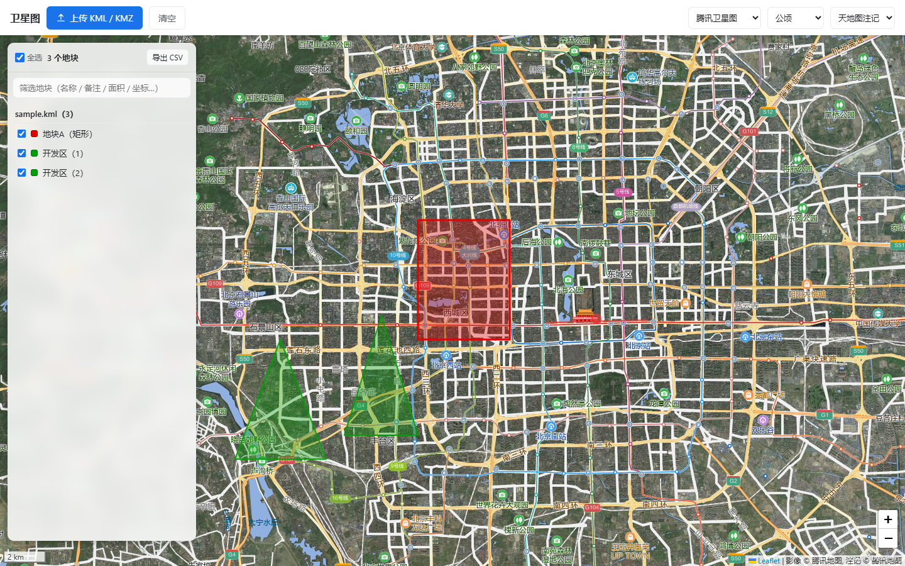 |

| 全选 / 导出 CSV |
| --- |
| 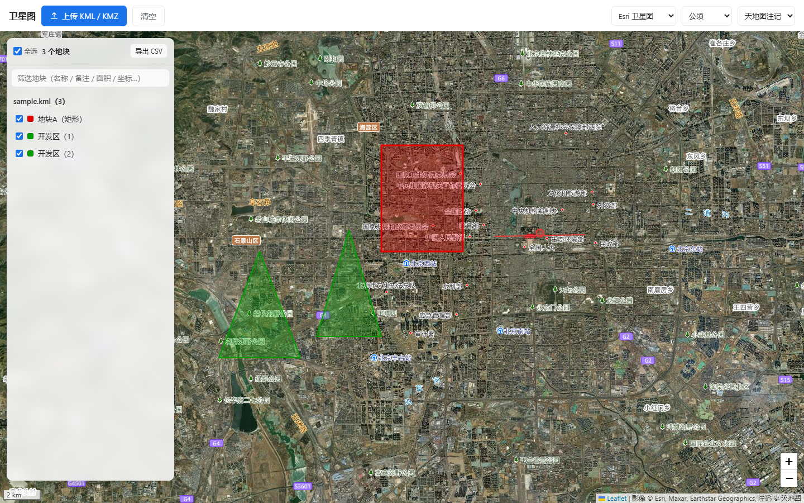 |

| 手机端首页 | 手机端加载与选中 |
| --- | --- |
| 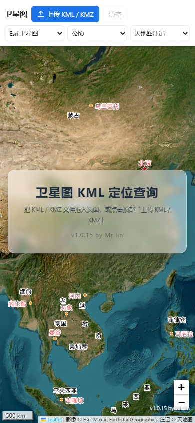 | 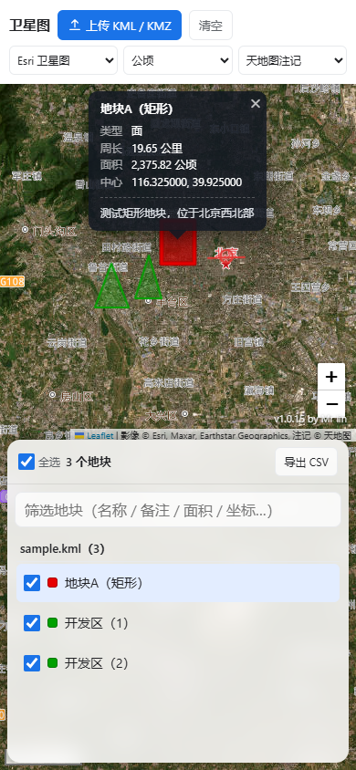 |

### 🚀 快速开始

**用户（部署即用）**

1. 双击打开 `index.html`（推荐用 Edge 或 Chrome）；
2. 点击「上传 KML / KMZ」或直接把文件拖进页面；
3. 点击要素或左侧条目选中并查看信息卡；双击左侧条目定位；再次点击 / 点空白 / Esc / × 取消选中；
4. 需要表格留档时，点侧栏「导出 CSV」保存当前地块（筛选时导出匹配行，否则导出勾选行）。

**开发者（本地预览）**

```bash
node scripts/serve.js        # 启动本地静态服务
# 浏览器访问 http://127.0.0.1:8000
```

**服务器部署（Docker + 阿里云 ACR）**

`deploy/` 内提供 Dockerfile、nginx 配置、docker-compose 与构建/推送脚本；完整步骤（ACR 准备、推送、服务器上线、升级回滚）见 [doc/DEPLOY.md](doc/DEPLOY.md) 方式四；使用 1Panel 面板部署见方式五（`deploy/docker-compose.1panel.yml`）。

无需构建，修改 `static/js/app.js`、`static/css/app.css` 后刷新即可生效。天地图注记与天地图卫星图需把 `config.example.js` 复制为 `config.js` 并填入自用 tk（天地图控制台创建「浏览器端」应用，白名单可留空；卫星图还需勾选影像与影像注记服务）；`config.js` 已被 `.gitignore` 忽略、不会入库，留空则自动使用 Esri 注记、天地图卫星图不可选。可选 `siteName` 用于自用站点名（如乡镇名），留空时页面标题显示「卫星图」。

### 🛠️ 技术栈

| 层 | 选型 | 说明 |
| --- | --- | --- |
| 地图 | Leaflet 1.9.4 | 轻量交互地图，BSD-2 许可 |
| 底图 | Esri World Imagery + 天地图卫星图 + 高德卫星图 / 高德普通地图 + 腾讯卫星图 | 官方公开瓦片服务，一键切换；天地图卫星图使用自配 tk，腾讯影像仅覆盖中国境内 |
| 注记 | 天地图 `cva_w` 透明注记 / Esri 注记 | 天地图注记需在 `config.js` 填入自用 tk（浏览器端密钥） |
| 解压 | JSZip 3.10.1 | KMZ（zip）解压，MIT 许可 |
| 解析 | @tmcw/togeojson 5.8.1 | KML → GeoJSON，BSD 许可 |
| 计算 | Turf.js 6.5.0 | 椭球面面积 / 周长 / 中心点，MIT 许可 |
| 依赖管理 | 无 | 全部库已本地化在 `static/libs/`，无构建步骤 |

### 🔒 数据与隐私

- 文件解析完全在浏览器本地完成，**不会上传到任何服务器**；
- 页面运行时仅从 Esri / 高德 / 天地图 / 腾讯官方瓦片服务加载影像、地图与注记（网络请求仅此一项）；
- 无 Cookie、无统计、无用户追踪。

### 📁 项目结构

```
kml/
├── index.html            # 页面入口（双击即用）
├── config.example.js     # 本地配置模板（复制为 config.js 填天地图 tk / 可选 siteName，config.js 不入库）
├── .github/workflows/    # GitHub Actions：打 tag 自动构建镜像并推送 ACR
├── static/
│   ├── libs/             # 本地化的第三方库（leaflet/jszip/togeojson/turf）
│   ├── css/app.css       # 界面样式
│   └── js/app.js         # 解析、渲染、交互逻辑
├── scripts/
│   └── serve.js          # 本地静态预览服务（node scripts/serve.js）
├── deploy/               # Docker/ACR 部署：Dockerfile、nginx.conf、compose、构建推送脚本
├── test/
│   ├── sample.kml        # 测试样例：面/线/点/多几何/样式/HTML描述
│   ├── sample_tiny.kml   # 测试样例：微小地块（验证缩放封顶）
│   ├── sample_gbk.kml    # 测试样例：GBK 编码
│   ├── doc.kml           # KMZ 内嵌文件源
│   ├── sample.kmz        # 由 make_samples.mjs 生成
│   └── make_samples.mjs  # 样例生成 + 预期值计算脚本
├── doc/
│   ├── images/           # 界面实拍截图
│   ├── DESIGN.md         # 设计方案
│   ├── PROJECT.md        # 开发技术文档
│   ├── PROJECT_STATE.md  # 项目状态 / 交接文档
│   ├── DEPLOY.md         # 部署手册
│   └── TEST.md           # 测试文档
├── CHANGELOG.md          # 更新日志
├── LICENSE               # MIT 许可证
└── README.md             # 本文件
```

### 🖱️ 常用操作

| 想做什么 | 怎么做 |
| --- | --- |
| 上传文件 | 点击「上传 KML / KMZ」或把文件拖进页面 |
| 查看要素详情 | 点击地图要素或左侧条目选中，信息卡立即弹出；再点一次 / 点空白 / Esc / × 取消 |
| 选中要素 | 点击即选中：面（地块）自动平移到屏幕中央、区域同色加深、侧栏行高亮、信息卡立即出现；点、线选中不移动地图 |
| 取消选中 | 再点同一要素 / 点地图空白处 / 按 Esc / 点信息卡 ×，四种方式任选 |
| 显示 / 隐藏某个地块 | 勾选 / 取消勾选该地块行前的复选框（默认全部勾选） |
| 全部显示 / 全部隐藏 | 点统计行左侧「全选」复选框：全不选时点击全选、全选时点击全不选、半选时点击全选 |
| 导出地块 | 点统计行右侧「导出 CSV」，导出当前可显示地块；无地块时按钮为禁用态 |
| 筛选地块 | 在侧栏筛选框输入关键字，匹配名称、备注、类型、文件名、周长、面积、中心坐标等全部信息，地图同步只显示匹配要素；清空恢复勾选状态 |
| 定位要素 | 双击左侧条目，飞至要素位置 |
| 切换底图 | 顶栏右侧下拉框：Esri 卫星图（默认）/ 天地图卫星图 / 高德卫星图 / 高德普通地图 / 腾讯卫星图（选择会被记住） |
| 切换面积单位 | 顶栏右侧单位下拉框（选择会被记住） |
| 显示/隐藏地名 | 顶栏右侧「注记来源」下拉：天地图注记（默认）/ Esri 注记 / 不显示（选择会被记住） |
| 清空全部 | 顶栏「清空」按钮：移除全部图层并平滑飞回初始视野，上传首页面板恢复 |

### 🐛 故障排查

| 症状 | 原因 / 修复 |
| --- | --- |
| 地图是灰色或加载缓慢 | 卫星瓦片来自 Esri / 高德官方服务，需要联网；网络慢时稍等片刻，或切换另一张底图 |
| 高德底图下要素与影像有偏移 | 属正常现象：高德瓦片是 GCJ-02 坐标系，本工具已自动纠偏；若偏移明显请确认底图与文件坐标系一致 |
| 双击后地图没有放大到极限 | 是有意设计：缩放封顶在底图有真实影像的层级（Esri / 高德 / 腾讯均 18 级）；乡村区域 19 级为占位图，页面已自动避开 |
| 腾讯卫星图境外区域空白 | 属数据覆盖范围：腾讯影像仅覆盖中国境内，境外请切回 Esri 卫星图 |
| 提示「解析失败：XML 解析失败」 | 文件不是合法的 KML/KMZ，或已损坏 |
| 提示「压缩包内未找到 KML 文件」 | KMZ 压缩包内没有 .kml 文件 |
| 中文名显示乱码 | 本工具已支持 GBK/GB18030；若仍乱码请用文本编辑器把文件另存为 UTF-8 |
| 大文件（>100MB）卡顿 | 浏览器解析需要时间，加载层会提示进度；建议拆分文件 |
| 选中后没有出现信息卡 | 信息卡在点击选中时立即弹出；若点地图空白处、Esc 或 × 关闭了卡片，选中也会一并取消 |
| 闭合线文件没显示在侧栏 | 只有首尾重合（1 米内）且不少于 4 个点的线会自动按地块处理；首尾未闭合的线只画在地图上、不进侧栏 |
| 筛选后地图上只剩部分要素 | 筛选会临时覆盖勾选状态、只显示匹配要素；清空筛选框即恢复勾选状态 |
| 注记下拉「天地图注记」或底图「天地图卫星图」是灰的 | 未配置天地图 tk：把 `config.example.js` 复制为 `config.js`，填入天地图「浏览器端」应用密钥后刷新（留空则自动用 Esri 注记、隐藏天地图卫星图） |
| 天地图卫星图放大后出现「此级别下，该区域无影像」 | 天地图公开影像止于 18 级，19 级起为占位图；本项目已封顶 18 级，属数据上限，不是加载失败 |
| 天地图卫星图灰屏或空白 | 检查该 tk 是否在控制台勾选了影像（img）与影像注记（cia）服务；页面会弹一次提示，其余底图不受影响 |
| 天地图注记较少或放大后变少 | 天地图乡村区域本身地名稀疏，18 级数据只有零星 POI（注记按原生字号显示，不放大）；如仍嫌少可切「Esri 注记」对照 |

### 📜 更新日志

详见 [CHANGELOG.md](CHANGELOG.md)

### 📄 许可证

[MIT](LICENSE)

---

## English

### What is this

A zero-dependency static web page. Drag & drop KML/KMZ files onto an Esri, Tianditu, Amap, or Tencent map (satellite or plain vector); check/uncheck plots to show or hide them, select or deselect all listed plots, filter plots by any field, export the current plots to CSV (UTF-8 BOM, Excel-friendly), and click to select a feature Google-style (same-color darkening; the info card opens immediately). Click again / click empty space / press Esc / click × to deselect. Closed lines (first point = last point) are treated as plots automatically. Tianditu Chinese labels (township / village / POI) can be overlaid on the Esri imagery without offset. Clicking "Clear" removes all layers and smoothly flies back to the initial world view, keeping your basemap / label / unit preferences.

### Tech Stack

Leaflet 1.9.4 (map) · JSZip (KMZ unzip) · toGeoJSON (KML parsing) · Turf.js (geodesic area/perimeter) · Esri World Imagery + Tianditu satellite (WGS84) + Amap / Tencent satellite (basemaps, automatic WGS84→GCJ-02 correction) · Tianditu labels (optional, own tk). All libraries are vendored locally, no build step required.

### Quick Start

Open `index.html` directly in a browser (Edge/Chrome recommended), or run `node scripts/serve.js` and visit `http://127.0.0.1:8000`.

### Data & Privacy

All file parsing happens locally in your browser. Files are never uploaded. The only network traffic is loading map tiles from Esri's, Amap's and Tianditu's public tile services.

### License

[MIT](LICENSE)
